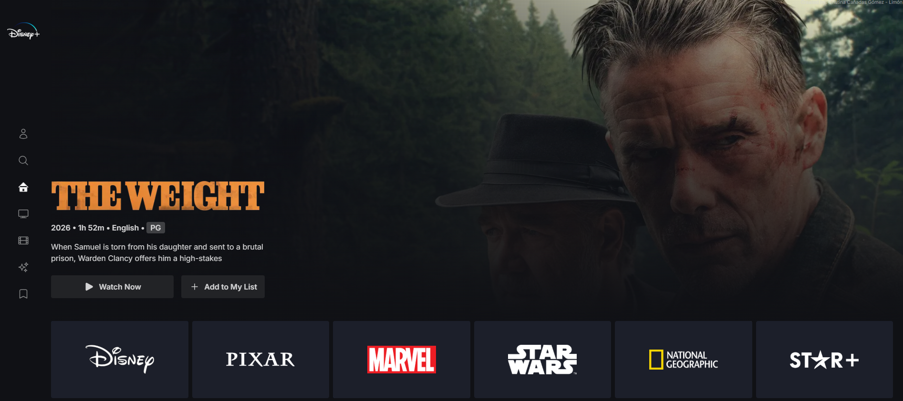

# Disney Plus Clone — DevSecOps CI/CD Demo

A full-featured Disney+ UI clone built with Next.js, used as the target
application for a **DevSecOps CI/CD pipeline** project: a real, working app
with a small set of **intentional, documented vulnerabilities** for SAST,
secrets-scanning, and dependency-review tooling to catch.



> **Credit / based on:** this project started from the
> [Disney Plus Clone](https://github.com/ntabucejo/disney-plus-clone) by
> **Nikko Abucejo**, whose original README states: *"Everything on this
> project is for learning purposes only. Feel free to copy/clone/fork the
> repository."* It was extended here with a Postgres backend, email/password
> authentication, a profile settings page, and the security work described
> below.

## What the app does

- Browse movies and series (data from [TMDB](https://www.themoviedb.org/))
- Sign in with **Google OAuth** or with **email + password**
  (new accounts must confirm their email before they can log in)
- Save titles to a personal **My List** watchlist, backed by **Neon Postgres**
- Manage account/profile settings (language, notifications, content
  preferences)

## Tech stack

Next.js (App Router) · TypeScript · Tailwind CSS · NextAuth.js ·
Neon Postgres (`pg`) · bcryptjs · Nodemailer · Framer Motion

## Getting started

```bash
npm install
cp .env.example .env   # fill in your own values — see below
npm run dev
```

Required environment variables (see `.env.example`):

| Variable | What it's for |
|---|---|
| `TMDB_API_KEY`, `TMDB_API_URL` | Movie/series data from TMDB |
| `NEXTAUTH_SECRET`, `NEXTAUTH_URL` | NextAuth session signing |
| `GOOGLE_ID`, `GOOGLE_SECRET` | Google OAuth sign-in |
| `DATABASE_URL` | Neon Postgres connection string (`neon link` generates this) |
| `SMTP_HOST` / `SMTP_PORT` / `SMTP_USER` / `SMTP_PASS` / `SMTP_FROM` | Outgoing mail for email verification — **optional**: with no `SMTP_HOST` set, the app auto-generates a disposable test inbox and logs a preview link to the console instead |

## Running with Docker

The app ships a multi-stage `Dockerfile` (small runtime image via Next.js
`output: "standalone"`, non-root user) plus a `docker-compose.yml`.

**Easiest path — Docker Compose** (reads build and runtime config straight
from your `.env`, no extra flags):

```bash
cp .env.example .env   # fill in your own values
docker compose up --build
```

**Plain `docker build`/`run`**, if you're not using Compose: `TMDB_API_KEY`
and `TMDB_API_URL` are needed *at build time* too (Next.js evaluates every
page once during `next build` to decide if it can be static, which runs the
TMDB fetches on the home/search/series/originals pages). They're passed in
as [Docker build secrets](https://docs.docker.com/build/building/secrets/)
— not `ARG`/`ENV` — so they're never written into an image layer or visible
via `docker history`:

```bash
export TMDB_API_KEY=your_key
export TMDB_API_URL=https://api.themoviedb.org
docker build --secret id=tmdb_api_key,env=TMDB_API_KEY \
             --secret id=tmdb_api_url,env=TMDB_API_URL \
             -t disney-plus-clone .

docker run -p 3000:3000 --env-file .env disney-plus-clone
```

> **Heads up:** `docker run --env-file` does **not** strip quotes the way
> `next dev` and Docker Compose's `env_file:` both do. If your `.env` values
> are quoted (`NEXTAUTH_URL="http://localhost:3000"`, as in `.env.example`),
> a plain `docker run --env-file` passes the quotes through literally and
> breaks `new URL(...)` calls in the app. Either strip the quotes for a
> Docker-only env file, or just use `docker compose up` instead, which
> handles this correctly.

No other secret (`DATABASE_URL`, `GOOGLE_SECRET`, `SMTP_*`, ...) is needed
at build time — those are only read at request time, inside the final
container, via the normal `--env-file`/`env_file:`.

## Why this repo has vulnerabilities in it

The point of a DevSecOps pipeline is proving that its security gates
actually catch something — a pipeline that only ever runs green on clean
code doesn't demonstrate anything. So this app intentionally ships three
real, exploitable flaws, each covering a different category:

| # | Vulnerability | Category | Where |
|---|---|---|---|
| 1 | SQL injection | Injection (SAST) | `library/watchlist.ts` → `searchWatchlistByTitle()`, `GET /api/watchlist/search?name=` |
| 2 | Stored XSS | Injection / unsafe rendering (SAST) | `components/sections/collection/portrait/card.tsx`, rendered on `/my-list` |
| 3 | Hardcoded secret | Secrets exposure (secret scanning) | `pages/api/auth/[...nextauth].ts` → fallback `clientSecret` |

Full write-up for each — exact payload used to verify it, why it works, and
the one-line fix — lives in **[`SECURITY_NOTES.md`](./SECURITY_NOTES.md)**,
along with:

- Real (non-staged) vulnerabilities that turned up from `npm audit` while
  building this and were fixed immediately, and
- Known gaps left on purpose for a DAST/config-review step to still catch
  (missing CSP, no rate limiting, user enumeration on signup).

**Don't deploy this app's current state as a real product** — the flaws
above are real and exploitable by design. They exist to be *found*, not to
ship.
